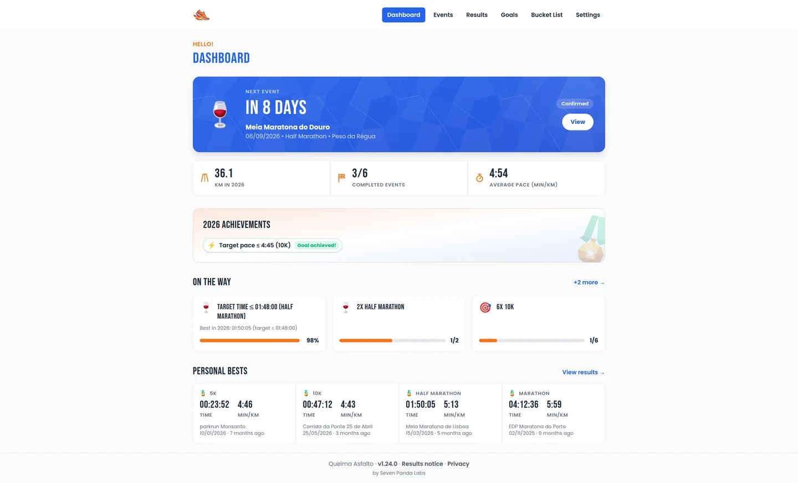
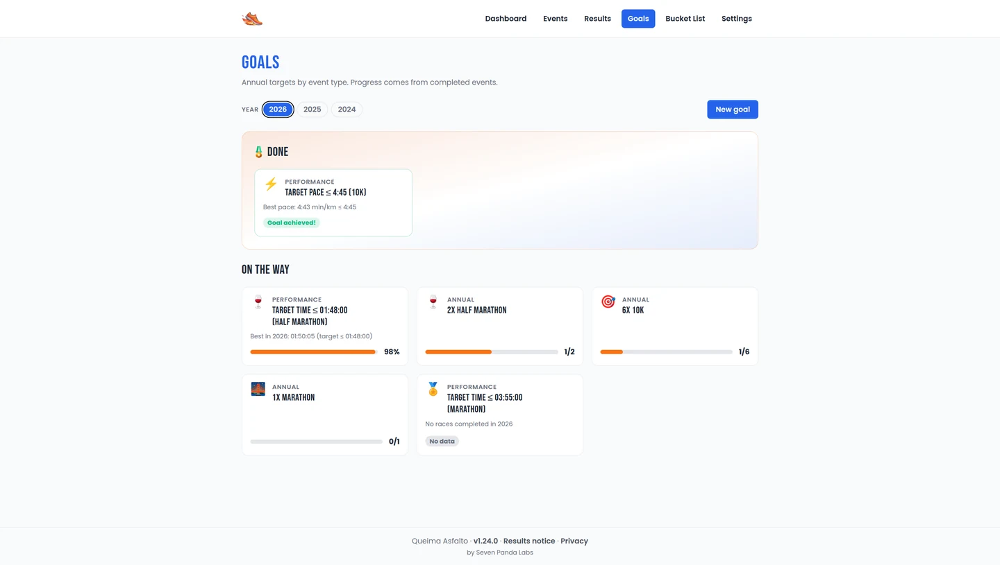
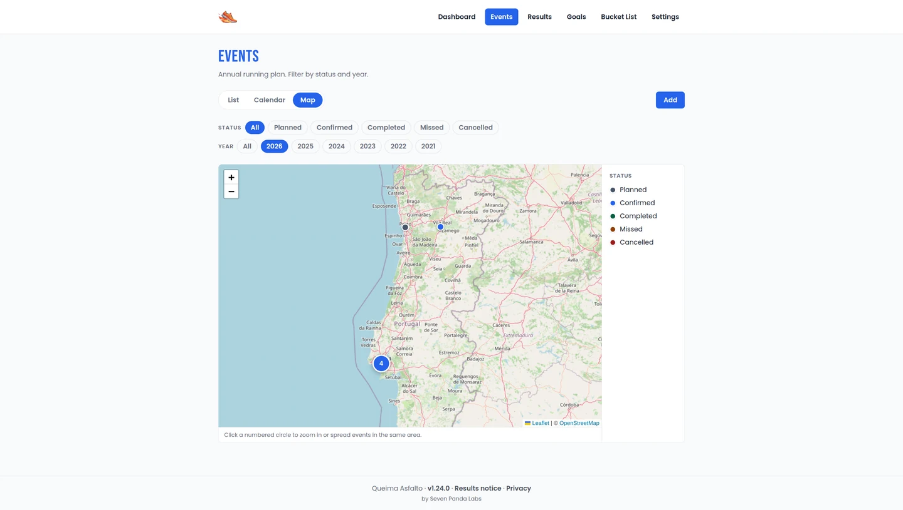
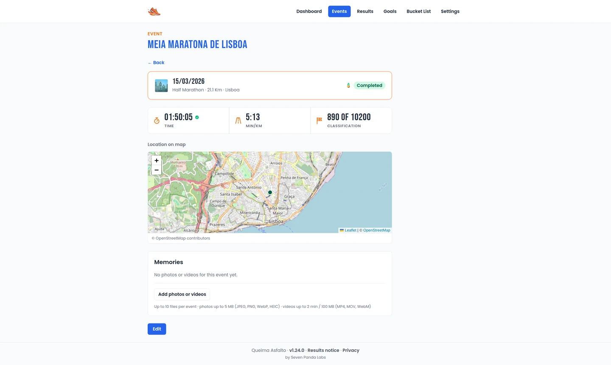
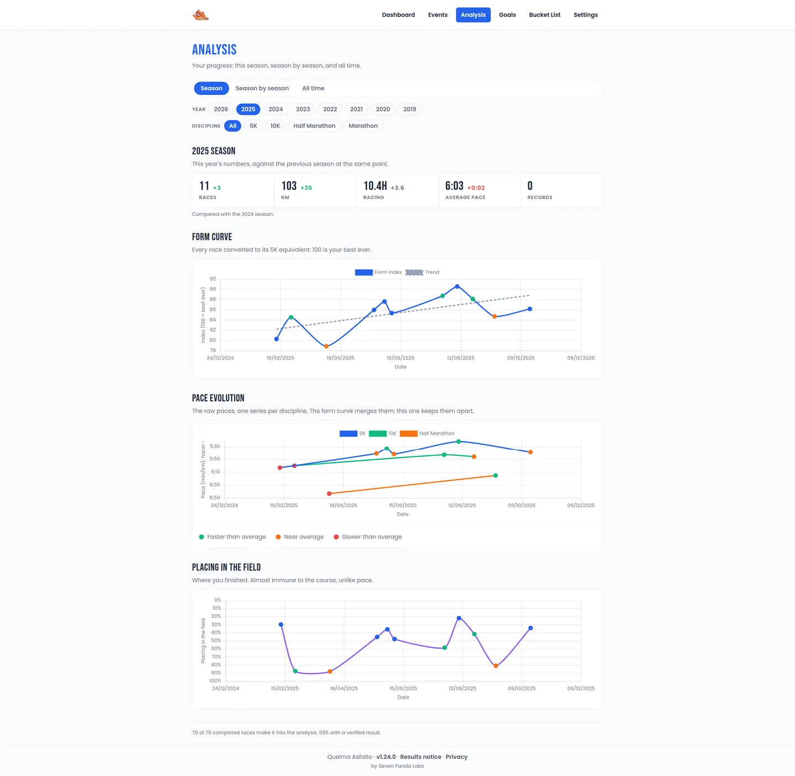
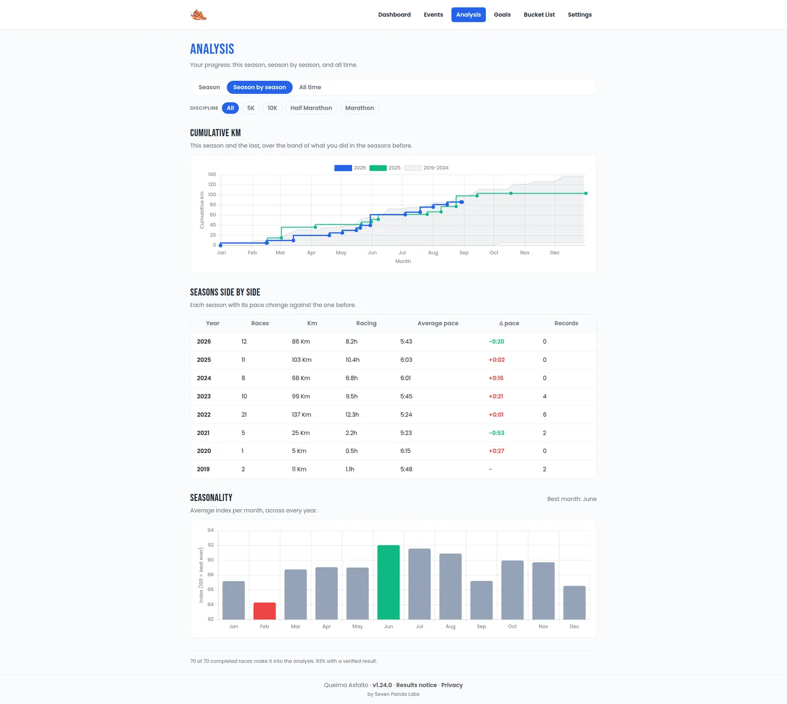

<p align="center">
  
</p>

<p align="center">
  <a href="https://github.com/Seven-Panda-Labs/queima-asfalto/actions/workflows/ci.yml"></a>
  <a href="https://github.com/Seven-Panda-Labs/queima-asfalto/blob/main/package.json"></a>
  <a href="LICENSE"></a>
</p>

# Queima Asfalto

**Português** · [English](#english)

<p align="center">
  
  
  <br />
  
  
  <br />
  
  
</p>

<a id="portugues"></a>

## Português

PWA para planear e acompanhar uma época de corrida. Funciona offline e sincroniza via Firebase. Instância oficial: [queima-asfalto.web.app](https://queima-asfalto.web.app).

- Planeamento da época e descoberta de corridas num catálogo partilhado
- Calendário de eventos com estados e mapa, lembretes e notificações push
- Objetivos anuais e metas de performance
- Resultados com importação de classificações oficiais
- Análise: curva de forma entre distâncias, época a época e desde sempre
- Ferramentas: calculadora de ritmo e registo de peso
- Partilha entre utilizadores; modo claro e escuro; seis idiomas (pt, en, es, de, fr, ar)

**Arrancar** (Node.js 24, Java 21+ para os emuladores):

```bash
npm install && npm --prefix functions install
cp .env.emulator.example .env.local
npm run emulators    # terminal 1
npm run dev          # terminal 2
```

Com um projeto Firebase teu: [`docs/self-hosting.md`](docs/self-hosting.md). Para contribuir: [`CONTRIBUTING.md`](CONTRIBUTING.md).

| Documento | Conteúdo |
|-----------|----------|
| [`architecture.md`](docs/architecture.md) | Como as peças encaixam |
| [`configuration.md`](docs/configuration.md) | Variáveis de ambiente |
| [`emulators.md`](docs/emulators.md) | Desenvolvimento local sem cloud |
| [`self-hosting.md`](docs/self-hosting.md) | Deploy num projeto Firebase teu |
| [`console-restrictions.md`](docs/console-restrictions.md) | Restrições de chaves no Console |
| [`adding-a-results-connector.md`](docs/adding-a-results-connector.md) | Novo conector de resultados |
| [`discovery-sources.md`](docs/discovery-sources.md) | Fontes do catálogo de corridas |
| [`race-catalog.md`](docs/race-catalog.md) | Catálogo e regra de revisão |
| [`planning-a-season.md`](docs/planning-a-season.md) | Do catálogo ao calendário |
| [`visual-identity.md`](docs/visual-identity.md) | Paleta, tipografia e tokens |
| [`voice.md`](docs/voice.md) | Tom de voz |

Licença [AGPL-3.0](LICENSE). Segurança: [`SECURITY.md`](SECURITY.md).

<a id="english"></a>

## English

[Português](#portugues)

PWA to plan and track a running season. Works offline and syncs via Firebase. Official instance: [queima-asfalto.web.app](https://queima-asfalto.web.app).

- Season planning and race discovery from a shared catalog
- Event calendar with statuses and map, reminders and push notifications
- Annual goals and performance targets
- Results with official race import
- Analysis: form curve across distances, season by season and all time
- Tools: pace calculator and weight log
- Sharing between users; light and dark mode; six languages (pt, en, es, de, fr, ar)

**Run it** (Node.js 24, Java 21+ for the emulators):

```bash
npm install && npm --prefix functions install
cp .env.emulator.example .env.local
npm run emulators    # terminal 1
npm run dev          # terminal 2
```

With your own Firebase project: [`docs/self-hosting.md`](docs/self-hosting.md). To contribute: [`CONTRIBUTING.md`](CONTRIBUTING.md).

| Doc | Contents |
|-----|----------|
| [`architecture.md`](docs/architecture.md) | How the pieces fit |
| [`configuration.md`](docs/configuration.md) | Environment variables |
| [`emulators.md`](docs/emulators.md) | Local development without the cloud |
| [`self-hosting.md`](docs/self-hosting.md) | Deploy to your own Firebase project |
| [`console-restrictions.md`](docs/console-restrictions.md) | API key restrictions in the console |
| [`adding-a-results-connector.md`](docs/adding-a-results-connector.md) | New results connector |
| [`discovery-sources.md`](docs/discovery-sources.md) | Race catalog sources |
| [`race-catalog.md`](docs/race-catalog.md) | Catalog and its review rule |
| [`planning-a-season.md`](docs/planning-a-season.md) | From the catalog to the calendar |
| [`visual-identity.md`](docs/visual-identity.md) | Palette, typography and tokens |
| [`voice.md`](docs/voice.md) | Brand voice |

License [AGPL-3.0](LICENSE). Security: [`SECURITY.md`](SECURITY.md).
