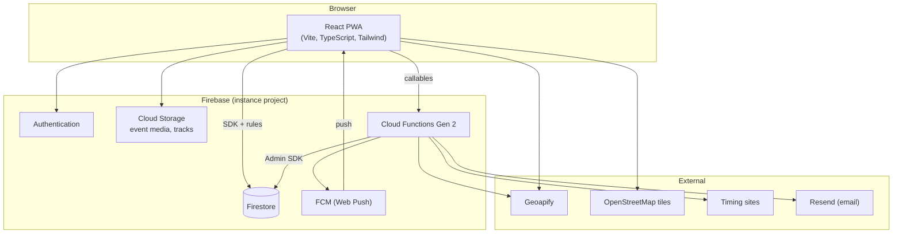

# Architecture

How the PWA, the Firebase backend and external services fit together. Deploy: [`self-hosting.md`](./self-hosting.md).



The PWA reads and writes Firestore and Storage directly, guarded by `firestore.rules` and `storage.rules`. Anything needing elevated privileges or third-party HTTP runs in Cloud Functions.

## Code layout

| Location | Holds |
|----------|-------|
| `src/` | The PWA: `pages/`, `components/`, `hooks/`, `contexts/`, `services/` (Firestore, Storage, callables, backup) |
| `shared/` | Pure logic used by the app **and** Functions (results parsing, shares, reminders, catalog). Copied into `functions/src/shared` by the Functions `build` script |
| `functions/src/` | Callables, scheduled jobs, timing connectors, catalog harvest |

## Two identities

```
      private half (per user)                        shared half
   ┌────────────────────────────────────┐      ┌─────────────────────────┐
   │  bucketListItems ──raceId──┐       │      │  raceCatalog/{id}       │
   │  raceEntries ────raceId──► races ──┼──────┼─► editions[], review    │
   │  events ─────────raceId────┘       │ cat. │                         │
   │     ├── media/{id}                 │ Race │  parkrunCatalog (slug)  │
   │     └── track/{id}                 │  Id  │                         │
   └────────────────────────────────────┘      └─────────────────────────┘
```

The only link between the halves is `races.catalogRaceId`. An event never points at the catalog directly, so two accounts can agree on which race it is while what each did in it stays private.

| Entity | Holds | Lives |
|--------|-------|-------|
| `races` | what the race is | forever |
| `bucketListItems` | that I want to run it | until scheduled |
| `raceEntries` | one year's attempt at getting in | one year |
| `events` | one running: date, result, media, track | one edition |
| `raceCatalog.editions[]` | one year of the race, publicly | per year, shared |

**A result is not an entity.** It is fields on the event (`time`, `pace`, `classification`, `resultsUrl`, `resultsPlatform`, `resultsVerified`, `outcomeReason`) plus the `media` and `track` subcollections. `trackPacingDriftSeconds` is denormalised onto the event so the Analysis page needs one query, not one per event.

**parkrun skips all of this.** Planning a parkrun creates the event directly, with no `raceId`: identity travels as `parkrunEventSlug`, and the shared substrate is `parkrunCatalog`.

## Firestore

Rules and the full list of collections: [`firestore.rules`](../firestore.rules), tested in `firestore.rules.test.ts`. Indexes: `firestore.indexes.json`.

Owned through a `userId` field: `events` (with `media` and `track` subcollections), `goals`, `performanceGoals`, `bucketListItems`, `races`, `raceEntries`, `weightEntries`. Under `users/{uid}`: `reminderDispatches` and `rateLimits` (server writes only). Catalog contributions (`raceCatalogProposals`, `raceCatalogEditionReports`, `raceCatalogDuplicateVotes`) carry a `uid` and are anonymized on deletion, not deleted. `adminDeleteAccount` keeps its own explicit copy of this list.

Shared: `raceCatalog` and its `raceCatalog*` companions (proposals, duplicate votes, edition reports, harvest status), see [`race-catalog.md`](./race-catalog.md), and `parkrunCatalog`, written only by the server. `shares` is written only by Functions.

**Backup** (`src/services/backupFormat.ts`): a `.zip` of the user's collections and profile as JSON, ids preserved on restore, optionally with media files (up to `MAX_BACKUP_MEDIA_TOTAL_BYTES`) and raw track files. `shares` is export-only. `reminderDispatches`, `rateLimits` and `fcmTokens` are left out.

## Cloud Functions

Exported from [`functions/src/index.ts`](../functions/src/index.ts); limits and region in [`functionOptions.ts`](../functions/src/functionOptions.ts).

| Group | Functions |
|-------|-----------|
| Account approval | `accountApprovalBeforeUserCreated`, `accountApprovalBeforeUserSignedIn` (blocking auth), `accountApprovalAction` (HTTP, link from the approval email) |
| Admin callables | `adminListUsers`, `adminSetAccountStatus`, `adminDeleteAccount`, `adminRecomputeTracks` |
| Results | `lookupOfficialResults` (callable) |
| Sharing | `inviteShare`, `acceptShare`, `getSharedSnapshot` and the rest from `shares.ts` |
| Scheduled | `dispatchReminders` (hourly), `harvestRaceCatalog` (daily), `syncParkrunCatalog` (weekly) |

**Results lookup.** `src/services/officialResultsLookup.ts` calls `lookupOfficialResults`, which checks the per-user cooldown, resolves the platform and calls the router in [`functions/src/connectors/index.ts`](../functions/src/connectors/index.ts). It returns candidates; the user confirms and the client writes the event. Adding a platform: [`adding-a-results-connector.md`](./adding-a-results-connector.md).

**Sharing.** The guest never reads the owner's Firestore. Functions read it and redact on the server (`shared/shares/redact.ts`, permissions in `shared/shares/permissions.ts`).

**Reminders.** Who gets what is decided in `shared/reminders/`; registration deadlines have their own cadence (`deadlineScheduler.ts`).

## External services

| Service | Where | Use |
|---------|-------|-----|
| Geoapify | Browser (`src/services/geoapify.ts`) and Functions (`functions/src/discovery/geocode.ts`) | Place autocomplete, geocoding catalog races |
| OpenStreetMap tiles | Browser (`src/components/EventMap/`) | Map background |
| Timing sites | Functions | Public results pages and APIs |
| Resend | Functions (`functions/src/email/send.ts`) | Account approval email |
| Google Analytics | Browser, optional (`src/services/analytics.ts`) | Usage stats |

Operator and terms-of-service notes: [`self-hosting.md`](./self-hosting.md).

## Offline

- Firestore persistent multi-tab cache when IndexedDB is available (`src/services/firebase.ts`).
- The Vite PWA service worker precaches the app shell.
- `parkrunCatalog/global` is the parkrun list; `src/data/parkrun-events.json` (`npm run sync:parkrun-events`) is the fallback when it is missing or stale.

## Local development

Emulators for Auth, Firestore, Functions and Storage: [`emulators.md`](./emulators.md). The ports are wired in `src/services/firebase.ts`; environment variables in [`configuration.md`](./configuration.md).
